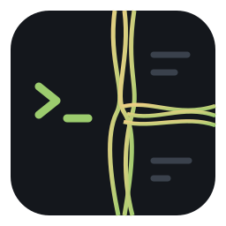

<p align="center"></p>

# lif

lif is a terminal multiplexer for macOS and Linux that keeps tmux's
commands, key bindings and target syntax, so most of what your hands and
scripts know about tmux works unchanged. It is a single-threaded Rust server
built on Ghostty's terminal engine (libghostty-vt), aimed at high output
throughput, low idle cost and a small self-contained binary.

Status: version 0.4.0. Enough of tmux is implemented for daily use; the list of
what is missing is below and in [docs/tmux-migration.md](docs/tmux-migration.md).

## Benchmarks

<!-- BEGIN BENCHMARKS: generated from bench/results/2026-11-15-2221-0.4.0-dev-summary.md; replace this whole block when the numbers are re-measured -->

lif 0.4.0 (measured just before the version was set) against tmux 3.8, zellij 0.46.0 and a bare
shell on the same PTY ("none"). One run on one machine (Mac18,5, Apple M6,
12 cores, 16 GiB, macOS 27.2; 2026-11-15) with other work running (load
average 3.8 at the start, 2.1 at the end), client PTY 200x50, every tool
with its default settings. Medians; spreads and sample counts are in
[bench/results/2026-11-15-2221-0.4.0-dev-summary.md](bench/results/2026-11-15-2221-0.4.0-dev-summary.md),
the methodology in [bench/README.md](bench/README.md), and the history of how
the numbers moved in [bench/results/comparison.md](bench/results/comparison.md).
Absolute latencies vary several-fold between runs on this machine for every
tool at once; compare tools within a run.

| | none | tmux 3.8 | zellij 0.46.0 | lif |
|---|---|---|---|---|
| `cat` 100 MB ASCII (MB/s) | 224.9 | 53.1 | 79.6 | 200.2 |
| `cat` 100 MB SGR-colored UTF-8 (MB/s) | 279.3 | 21.1 | 81.8 | 148.9 |
| `cat` one 20 MB line (MB/s) | 165.4 | 52.9 | 17.6 | 162.4 |
| server memory, idle, 1 pane (MiB, footprint / RSS) | - | 3.7 / 5.2 | 25.2 / 41.7 | 3.5 / 5.5 |
| server memory, idle, 50 visible panes (MiB) | - | 4.2 / 5.7 | 37.5 / 54.5 | 10.0 / 12.2 |
| server memory, 100k colored lines of history (MiB) | - | 289.7 / 291.2 | 232.0 / 248.5 | 43.5 / 236.0 |
| server memory after a 100 MB `cat` (MiB), lines kept | - | 6.1 / 7.6, 1,818 | 44.1 / 60.7, 9,997 | 5.7 / 14.0, 3,784 |
| server over 30 s idle: CPU ms, interrupt wakeups | - | 1.4, 3 | 29.7, 363 | 0.0, 0 |
| create session + kill server (ms) | - | 11.0 | 52.5 | 5.3 |
| attach, draw, detach (ms, includes a 20 ms wait) | - | 31.8 | 63.6 | 29.3 |
| new session until a typed command runs (ms) | 31.6 | 54.6 | 85.4 | 39.1 |
| key echo, idle pane, p50 / p95 (us) | 16 / 23 | 118 / 167 | 436 / 619 | 102 / 155 |
| key echo while another pane runs `yes`, p50 / p95 (us) | - | 262 / 330 | 948 / 1,066 | 39 / 48 |
| bare ESC to the program, default settings, p50 (us) | 46 | 11,535 | 59,782 | 5,506 |
| bare ESC with `escape-time 0` / kitty keyboard protocol, p50 (us) | - | 1,415 / - | - | 137 / 140 |
| binary size (MB) | - | 1.19 + 4 Homebrew dylibs | 73.07 | 3.54, system libraries only |

Where lif still loses: each extra visible pane costs about 140 KiB (tmux:
about 11 KiB), so 50 idle panes take 10.0 MiB against tmux's 4.2 MiB. After
large output its RSS stays higher than tmux's (14.0 MiB against 7.6 after the
100 MB `cat`) although its footprint is lower: compressed history leaves its
old pages resident until macOS reclaims them, which is also why 100k lines of
history show 236 MiB resident for a 43.5 MiB footprint. Plain ASCII went
through at 89% of the bare shell's rate in this run. The binary is 3.0 times
tmux's.

<!-- END BENCHMARKS -->

## Install

There are no packages yet; build from source.

Requirements:

- Rust 1.96 or newer.
- Zig 0.17 on `PATH`. The terminal engine, libghostty-vt, is compiled from
  source by its build script.
- macOS on Apple Silicon is the only tested platform (see [Platforms](#platforms)).

```sh
git clone <this repository> lif && cd lif
cargo build --release -p lif
cp target/release/lif ~/.local/bin/   # or anywhere on PATH
```

The binary is self-contained: libghostty-vt is linked statically and it only
links system libraries (`otool -L` shows `libSystem` and `libiconv`). There
is no terminfo entry, runtime directory or plugin to install. A man page source
is in [docs/lif.1](docs/lif.1) (`man ./docs/lif.1`).

## Quick start

The five things a tmux user does first, with the same keys (prefix `C-b`):

```sh
lif                      # new session, attached (same as: lif new-session)
lif new -s work          # named session
```

| Do | Keys | Command |
|---|---|---|
| Split side by side / top and bottom | `C-b %` / `C-b "` | `split-window -h` / `split-window` |
| Move between panes | `C-b` + arrow, `C-b o`, `C-b ;` | `select-pane -L/-R/-U/-D` |
| New window, next / previous, by number | `C-b c`, `C-b n` / `C-b p`, `C-b 0`..`9` | `new-window`, `next-window`, `select-window -t :=N` |
| Scroll back and copy | `C-b [`, move, `Space`/`C-Space` to start, `Enter`/`M-w` to copy, `C-b ]` to paste | `copy-mode`, `paste-buffer` |
| Detach and come back | `C-b d`, then `lif attach` (or `lif a -t work`) | `detach-client`, `attach-session` |

`C-b z` zooms a pane, `C-b x` kills it after confirmation, `C-b :` opens the
command prompt, `C-b ?` lists the key bindings. `lif ls` lists sessions and
`lif kill-server` stops everything. Commands take the same flags and targets as
tmux, for example `lif split-window -h -t work:1.0 -c ~/src` or
`lif display-message -p '#{session_name}:#{window_index}'`.

## Same as tmux

- Prefix `C-b`, and tmux 3.8's default bindings for the commands lif has (73 of
  tmux's 93 default prefix bindings are identical; the rest are listed in the
  migration guide). The copy-mode tables (`copy-mode`, `copy-mode-vi`) are
  tmux 3.8's, minus the mouse entries and emacs `L`.
- Command names, aliases (`splitw`, `neww`, `a`... and unambiguous prefixes),
  flags, the command language (`;` separators, `{ }` blocks, quoting), and the
  error messages for unknown commands, options and targets.
- Targets: `session:window.pane`, `$id`, `@id`, `%id`, `=exact`, `{last}`,
  `{next}`, `+N`/`-N`, `{top}`/`{bottom}`/`{left}`/`{right}`, `{marked}`
  (`~`), `{mouse}` (`=`), globs.
- Formats: `#{variable}`, `#S #I #W #P #T #D #F #H #h`, conditionals,
  comparisons and the common modifiers (`=N`, `pN`, `t:`, `b:`, `d:`, `l:`,
  `E:`, `T:`, `q:`, `n:`, `w:`, `s/a/b/:`, `m:`, `e|op|:`),
  strftime in the status line, and `#(shell command)`.
- Scripting: `run-shell` (output, exit status, `-b`, `-d`, `-C`),
  `if-shell` (also `-F`), `wait-for` (channels and locks), hooks
  (`set-hook`, `show-hooks`, tmux's hook names) and the environment
  commands (`set-environment`, `show-environment`, `-e` on the commands
  that create panes), with tmux's output and messages.
- Option names, scopes (`-s`, `-g`, `-w`, `-p`, per session, window and
  pane) and the defaults of the 85 tmux options lif has (except
  `escape-time`, `history-limit`, `pane-border-format`, `focus-events`
  and the popup and menu styles), plus user options (`@name`).
- Layouts: `even-horizontal`, `even-vertical`, `main-horizontal`,
  `main-vertical`, their `-mirrored` variants, `tiled`, and tmux layout
  strings in `#{window_layout}`.
- The chooser modes: `choose-tree` (`C-b s`, `C-b w`), `choose-buffer`
  (`C-b =`), `choose-client` (`C-b D`) and `find-window` (`C-b f`), with
  tmux's list, tree, preview and keys.
- `pipe-pane`, `clock-mode` (`C-b t`), `resize-window`, `respawn-window`,
  `split-window -f`, `select-pane -d`/`-e`, the prompt history commands, and
  tmux's notes on the default keys (`C-b /` describes a key).
- Popups and menus: `display-popup` (sizes, positions, borders, `-E`,
  the exit status) and `display-menu`, with `C-b <` and `C-b >`.
- Mouse keys in the root table, with tmux's names and default bindings:
  `bind -n MouseDown3Pane ...`, `unbind -n WheelUpPane`, the target `=`,
  `send-keys -M`, `copy-mode -M`, `resize-pane -M`, the `mouse_*` formats,
  and the right-button menus on panes and on the status line.
- The marked pane: `select-pane -m` / `-M` (`C-b m`, `C-b M`), the
  default source of `swap-pane`, `join-pane` and `swap-window`.
- A server per socket, started by the first client, sessions surviving detach.

## Deliberately different

- **Configuration is TOML**, at `~/.config/lif/config.toml` (or
  `$XDG_CONFIG_HOME/lif/config.toml`, or `$LIF_CONFIG`), not a file of tmux
  commands. lif does not read `~/.tmux.conf`. `lif migrate-tmux-conf`
  translates the common part of one and lists every line it could not
  translate; `lif check-config` reports mistakes with line, column and a
  suggestion. See [docs/configuration.md](docs/configuration.md).
- **Scrollback has two limits per pane**: `history-limit` in lines (default
  4000, tmux's is 2000) and a memory budget, `scrollback-bytes` (`scrollback =
  "10MB"` in the configuration file); both hold. Changing either applies to
  existing panes too (in tmux only to new ones). History a quiet pane holds is
  compressed after 2 s.
- **Clipboard and notifications pass through.** Copying in copy mode sets the
  outer terminal's clipboard with OSC 52 (`set-clipboard external`, the
  default), and OSC 52 from programs in panes is forwarded too (tmux 3.8's
  `external` drops it; `set-clipboard off` stops both). Desktop notifications from
  programs (OSC 9, OSC 777, OSC 99) reach the outer terminal as OSC 9.
- **Kitty keyboard protocol end to end.** When the outer terminal answers the
  kitty keyboard query, lif enables the protocol there (and restores it on
  detach); keys are then encoded for each pane according to the keyboard mode
  the program in that pane asked for, kitty or legacy.
- **`escape-time` defaults to 5 ms** (tmux: 10), and with the kitty protocol
  active there is no wait at all: the Escape key is unambiguous and is
  delivered at once. `escape-time 0` never waits, as in tmux.
- **TERM inside panes is `xterm-256color`**, with `COLORTERM=truecolor` and
  `TERM_PROGRAM=lif`. There is no `default-terminal` option and no
  `tmux-256color`-style terminfo entry to install.
- **`$LIF` instead of `$TMUX`.** Panes get `LIF=<socket>,<server pid>,<session id>`
  and `LIF_PANE=%N`; `TMUX` is not set (and is removed from the environment
  panes inherit). `lif` run inside a pane talks to that pane's server
  through `$LIF` unless `-S` or `-L` is given, and refuses to attach unless
  `$LIF` is unset, as tmux does with `$TMUX`.
- **Shell commands run with `/bin/sh`**, whatever `default-shell` is (tmux
  uses `default-shell`): `run-shell`, `if-shell`, `#()` and `copy-pipe`.
  At most 64 commands of the first three run at once and 1 MiB of a
  command's output is kept. A `#()`
  command runs again when the status line is redrawn and its last run
  started `status-interval` seconds ago or more (tmux: one second), and
  only a status line that uses `#()` is redrawn on that interval; an idle
  server still wakes for nothing else.
- **`set-environment` holds only what you set.** Panes get the server's
  environment plus a few variables of the client that creates the session;
  `set-environment` (and `[env]` in the configuration file) adds to or
  removes from that, and `show-environment` lists just those entries
  (tmux lists the whole environment). There is no `update-environment`
  option.
- **Hooks that exist but never run.** `set-hook` takes every tmux 3.8 hook
  name; the ones lif runs are the `after-` hooks of the commands it has
  and `session-created`, `session-closed`, `session-renamed`,
  `session-window-changed`, `window-linked`, `window-unlinked`,
  `window-renamed`, `window-layout-changed`, `window-pane-changed`,
  `client-attached`, `client-detached`, `client-session-changed`,
  `client-resized`, `pane-exited`, `pane-died`, `alert-bell` and
  `alert-activity`.
- **The mouse inside copy mode is built in.** Mouse keys are bound in the
  root table as in tmux, but the copy-mode tables have no mouse entries:
  what a click, a drag or the wheel does once a pane is in copy mode is
  fixed, and the `mouse-drag-end` option replaces rebinding
  `MouseDragEnd1Pane`. A mouse key left at its default is handled by the
  server directly instead of running its commands (same result, no command
  parsing per event). See the migration guide's Mouse section.

## Claude Code

Claude Code runs in a lif pane without configuration: Shift+Enter,
synchronized output, OSC 52 copying, notifications and true color pass
through. Its agent teams can open their teammates in lif panes as they do in
tmux: `lif install-tmux-shim` and `tmux-compat = true` make lif answer for
`tmux` inside lif panes, with pane options, border titles
(`pane-border-status`), `select-pane -T` and `load-buffer -w -`. See
[docs/claude-code.md](docs/claude-code.md).

## Not implemented

Checked against the command table and by running each one (they fail with
`unsupported command: NAME`):

- Floating panes (`new-pane`, `move-pane`), scrollbars, and the mouse
  keys that belong to them.
- `customize-mode`, `switch-mode`.
- Session groups and linked windows (`new-session -t`, `link-window`,
  `unlink-window`).
- Locking, `server-access`.
- Control mode (`-C`), most of tmux's 204 options (lif has 85
  of them, plus 3 of its own).
- Images (sixel, kitty graphics), Windows. tmux plugins (TPM) are not
  supported: they are scripts that call `tmux` and read `.tmux.conf`.

## Configuration in brief

```toml
# ~/.config/lif/config.toml
prefix = "C-a"          # also unbinds C-b and binds C-a to send-prefix
mode-keys = "vi"
scrollback = "64MB"
base-index = 1

[status]
position = "top"

[theme]
status = { bg = "#1e1e2e", fg = "#cdd6f4" }
current-window = { fg = "black", bg = "green", bold = true }

[keys]
"|" = "split-window -h -c '#{pane_current_path}'"
"-" = "split-window -v -c '#{pane_current_path}'"
h = { command = "select-pane -L", repeat = true }
"C-o" = false            # remove a default binding

[keys.copy-mode-vi]
v = "send-keys -X begin-selection"

[hooks]
after-split-window = "select-layout tiled"

[env]
EDITOR = "nvim"
```

The file is read when the server starts; `lif source-file ~/.config/lif/config.toml`
reloads it. Mistakes never stop the server: the rest of the file still
applies, and the errors go to `lif show-messages`. `lif print-config` prints
the documented default file. Full reference: [docs/configuration.md](docs/configuration.md).

## Architecture

- **One server thread, one event loop** (`mio`: kqueue on macOS, epoll on
  Linux). No thread per pane and no periodic timers: an idle server sleeps
  until there is I/O.
- **Terminal engine: libghostty-vt** (Ghostty's VT parser and screen model,
  linked statically). Each pane's output is parsed as fast as it can be read.
- **Diff renderer with frame skipping, not output queues.** Nothing is queued
  per client. When a client can take a frame, lif renders the newest state of
  its panes as a diff against what that client shows, at most one frame per
  8 ms for output nobody typed for; intermediate states are skipped. The echo
  of a key is drawn at once, in the same loop iteration, and only the echoing
  pane is refreshed for it, so typing stays fast next to a pane flooding output.
- **The server drives the terminal.** The client puts its terminal in raw mode
  and hands it over: the server opens the same terminal by path and reads
  keys from it and writes frames to it directly, so a keystroke costs the
  client nothing. The client only forwards resizes and signals. If the server
  cannot open the terminal, the client relays bytes instead.
- **Memory per pane follows what is shown.** A pane no client shows keeps only
  its terminal (no frame or render state); a pane that was resized is
  repacked once it is quiet; history is compressed after 2 s without output.

| Crate | Role |
|---|---|
| `lif` | The binary: command line, server start-up |
| `lif-server` | Event loop, panes, clients, frame scheduling |
| `lif-core` | Sessions, windows, panes, layouts, command language, options, key bindings, formats (no I/O) |
| `lif-vt` | `VtEngine` trait and the libghostty-vt backend |
| `lif-pty` | PTYs and child processes |
| `lif-input` | Parser for bytes from the outer terminal (keys, mouse, kitty protocol, replies) |
| `lif-render` | Compositor and diff renderer |
| `lif-client` | The attached client |
| `lif-proto` | Client-server protocol |
| `lif-copy` | Copy mode |
| `lif-config` | The TOML configuration file and the `.tmux.conf` translator |
| `lif-types` | Shared types |
| `bench/` | Benchmark harness against tmux and zellij |

## Platforms

- **macOS on Apple Silicon (arm64)**: where it is developed, and the only
  platform it has been benchmarked on.
- **Linux on arm64**: the whole test suite passes on Ubuntu 26.04 (kernel
  7.0) in a virtual machine, with one test set aside: next to a pane that
  floods its output, the echo of a key takes about 4 ms there instead of
  well under one (issues/0006). No benchmarks have been run on Linux.
  x86_64 Linux is built and tested only by the CI workflow
  (`.github/workflows/ci.yml`).
- Other Unix systems: untested. Windows: not supported.

## License

MIT (as declared in `Cargo.toml`).

## Acknowledgements

- [Ghostty](https://ghostty.org)'s libghostty-vt is the terminal emulator inside
  every pane, used through the libghostty-rs bindings.
- [tmux](https://github.com/tmux/tmux) is the behavioral reference: its
  commands, key tables, options, formats, targets and messages are what lif
  reproduces, and tmux 3.8 is what lif was compared against.
